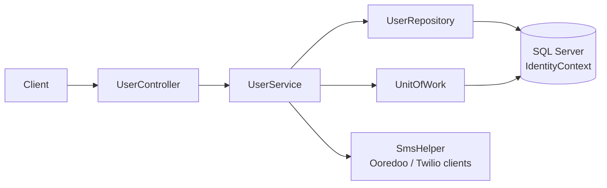

# ChatApp

The beginnings of a microservice-based chat application: an Identity service for phone-number based users and OTP codes.

> **📦 Archived** — this is a learning project from 2022, kept for reference. It is not maintained and is not production-ready. Only the Identity service was started.


## Overview

`IdentityService.Api` manages chat users identified by dialing code + mobile phone and generates one-time passwords for login:

| Method | Route | Description |
|---|---|---|
| `POST` | `/api/User` | Create a user |
| `PUT` | `/api/User/{id}` | Update a user |
| `DELETE` | `/api/User/{id}` | Delete a user |
| `GET` | `/api/User/GetByPhoneNumber/GetByPhoneNumber?dialingCode=&mobilePhone=` | Find a user by phone number |
| `GET` | `/api/User/SendOTPMessage?dialingCode=&mobilePhone=` | Generate a 4-digit OTP (random, or `1111` when `IsRandomOtpCode` is `false`) |

All responses are wrapped in the shared `Response<T>` envelope (`data`, `errors`).

## Architecture



- Repository + Unit of Work over EF Core; user IDs use a SQL Server HiLo sequence.
- AutoMapper maps between the `User` entity and the `UserResource` API model.
- On startup the database is created with `EnsureCreated()` inside a Polly retry policy.
- `ChatApp.Shared` holds the `Response<T>` envelope and a base controller that turns it into an HTTP result.

## Tech stack

.NET 5 · ASP.NET Core Web API · EF Core 5 (SQL Server) · AutoMapper · Polly · Swagger · Twilio SDK

## Project structure

```
src/
├── ChatApp.sln
├── Common/ChatApp.Shared/                     # Response<T>, NoContent, CustomBaseController
└── Services/IdentityService/IdentityService.Api/
    ├── Controllers/        # UserController
    ├── Services/           # UserService, platform/session abstractions
    ├── Infrastructure/     # DbContext, entity configuration, repositories, unit of work
    ├── Helpers/            # SMS, request and conversion helpers
    ├── Extensions/         # DB registration, Ooredoo SMS client
    └── Resources/, Models/ # API models and entities
```

## Getting started

**Prerequisites**

- .NET 5 SDK — or any newer SDK; to run on a machine without the .NET 5 runtime set `DOTNET_ROLL_FORWARD=Major`
- Docker (for SQL Server)

```bash
docker run -d --name chatapp-sql -e ACCEPT_EULA=Y -e 'MSSQL_SA_PASSWORD=Your_password123' \
  -p 1433:1433 mcr.microsoft.com/mssql/server:2022-latest

# The default connection string targets SQL Server LocalDB (Windows); override it elsewhere:
export ConnectionStrings__IdentityConnectionString='Server=localhost,1433;Database=IdentityDb2;User Id=sa;Password=Your_password123;TrustServerCertificate=True'

dotnet run --project src/Services/IdentityService/IdentityService.Api --environment Development
```

Swagger UI is served at `/swagger` in the Development environment.

## Notes / limitations

- SMS delivery is not wired up: `SmsHelper.Send` currently does nothing, so OTP codes are only returned in the API response.
- If the Twilio client is enabled, it reads `TWILIO_ACCOUNT_SID`, `TWILIO_AUTH_TOKEN` and `TWILIO_FROM_NUMBER` from environment variables.
- Passwords are stored as plain text; there is no authentication or OTP verification endpoint.
- .NET 5 is out of support; the projects are kept on their original target framework.

## License

[MIT](LICENSE)
